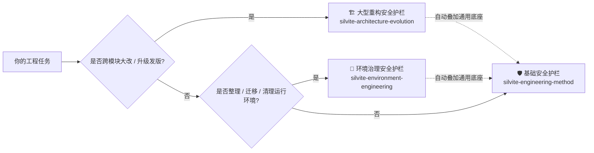

<!--
GitHub About:
A reusable Agent-native software engineering method for scoped execution, evidence-based verification, complexity control, and reversible change.

Topics:
ai-agents, agentic-coding, codex, software-engineering, engineering-methodology, developer-tools, agent-skill, vibe-coding
-->

<div align="center">

# 🛡️ Silvite Engineering Method

**给 AI Coding Agent 装上「刹车、边界和体检表」**

*写得快之前，先让它知道：改哪里、不能碰哪里、怎么留退路、什么才叫真正完成。*


[三大核心护栏](#-三大核心护栏) · [它解决什么痛点](#-为什么你需要它) · [30 秒安装使用](#-30-秒安装与上手) · [评测与透明边界](#-实测与安全边界) · [目录速览](#-仓库结构)

</div>

---

## 💡 为什么你需要它？

现在的 AI 写代码、跑命令已经很快了，但用久了你一定会遇到这几种**翻车名场面**：

| 😵 没有护栏的 AI 常见操作 | 🛡️ 装上 Silvite 护栏之后 |
| :--- | :--- |
| 让它修个小 Bug，结果**“顺手”重构了一堆无关文件** | **划定边界**：只改目标范围，无关代码一律不碰 |
| 没留备份就直接删环境、改配置，**炸了回不去** | **先留退路**：高风险动作先备份/只读盘点，验证可恢复再动手 |
| 给你写一页华丽的脚本和表格，结果**正事一行没交** | **拒绝摸鱼造轮子**：小事直接做，禁止为省事搭无用框架拖延交付 |
| 跑了个局部测试或旧报告，就自信宣布 **“全部完成”** | **拿证据说话**：新开终端/真跑通才算完成，没测就老实标 `未验证` |

> **一句话总结：** AI 负责高效率干活，**Silvite 负责替你守住边界、证据和回退点。**

---

## 🧭 三大核心护栏

仓库只保留 **3 套职责清晰、互不重复** 的核心 Skill，按需单装或组合使用：



| 护栏 | 适合什么场景 | 它帮你拦住什么 |
| :--- | :--- | :--- |
| **🛡️ 基础安全护栏**<br>`silvite-engineering-method` | **日常必装**：修 Bug、加功能、局部重构、写脚本 | 瞎扩范围、覆盖你没提交的代码、小活硬搭大框架、无证据喊“已完成” |
| **🏗️ 大型重构安全护栏**<br>`silvite-architecture-evolution` | **大改/发版**：跨模块替换、协议演进、多端同步、构建发布 | 一口气重写整条链路、版本号改乱导致无法升级、未授权修改排除仓库、危险命令接触真实密钥 |
| **🧰 环境治理安全护栏**<br>`silvite-environment-engineering` | **环境整理**：清理宿主机 `PATH`、隔离 Conda/venv、迁移环境目录、容器/WSL/备份恢复 | 直接剪切移动环境导致路径全炸、删错正在被后台服务使用的依赖、清混装包弄坏底座、只在当前窗口假通过 |

---

## ⚙️ 核心机制（3 分钟看懂，不说黑话）

1. **先看再动，先讲范围**
   先只读排查现状，分清“实锤看到的”和“猜的”。涉及到改公共接口、扩大权限或碰未确认范围时，**必须停下来问你**。
2. **能直接做，就别先造工具**
   几分钟能手工搞定的事，禁止 AI 先写一堆脚本、配置文件和调度器来“看起来很努力”。如果半天没产出第一个正经成果，立刻触发警报回到正题。
3. **高风险操作四步走**
   `先盘点备份 → 预演/dry-run → 最小范围执行 → 真环境复验`。比如迁移隔离环境时，**必须先扫描新环境里有没有残留旧路径硬编码，再删旧环境**，防止“旧环境还在所以假装能跑”。
4. **把完成状态说老实**
   Silvite 禁止 AI 用“大概好了”糊弄你，必须按实测结果归入以下四态之一：
   - ✅ `Completed`：目标结果 + 必要测试都刚跑通
   - 🩹 `Mitigated`：先止血/临时绕过了，但根因还没彻底解决
   - ⚠️ `Unverified`：代码/配置改了，但关键环境或冷启动还没真测
   - 🚫 `Blocked`：缺权限、缺基线或安全门禁拦截，**停止写入并交给你拍板**

---

## 🚀 30 秒安装与上手

### 第一步：克隆并放进你的 Agent Skills 目录

以常用的 `~/.agents/skills` 为例（Antigravity / Codex 等支持 `SKILL.md` 的宿主按各自目录放入即可）：

```bash
git clone https://github.com/LaoYinBai/Silvite-Engineering-Method.git
cd Silvite-Engineering-Method

# 1. 必装：基础安全护栏
mkdir -p ~/.agents/skills/silvite-engineering-method
cp SKILL.md ~/.agents/skills/silvite-engineering-method/
cp -R references ~/.agents/skills/silvite-engineering-method/

# 2. 按需加装：大型重构 & 环境治理护栏
cp -R silvite-architecture-evolution ~/.agents/skills/
cp -R silvite-environment-engineering ~/.agents/skills/
```

### 第二步：干活时直接点名调用（复制即用）

> [!TIP]
> 支持自动 Skill Discovery 的 Agent 会按需自动触发；你想强约束它时，直接在提示词里点名即可：

- **日常开发 / 修 Bug：**
  ```text
  使用 $silvite-engineering-method 完成这次修改：先只读确认范围和回退点，别顺手改无关代码，完成后给出真实运行证据。
  ```
- **跨模块大重构 / 发版：**
  ```text
  同时使用 $silvite-engineering-method 和 $silvite-architecture-evolution：先冻结基线和不可破坏的不变量，按切片迁移并逐层验证升级/产物证据。
  ```
- **清理、隔离或迁移本机/容器环境：**
  ```text
  同时使用 $silvite-engineering-method 和 $silvite-environment-engineering：先只读盘点现状、消费者和硬链接，禁止直接剪切或盲删，改完用剥离继承态的新终端冷启验证。
  ```

---

## 🧪 实测与安全边界

### 我们怎么验证这些规则不是“纸上谈兵”？

仓库使用 **Control（无 Skill）vs Treatment（加载 Skill）** 的压力场景做对比，看 AI 的**实际决策**有没有变好，而不只是嘴上说得好听。几个典型考题示例：

- **基础护栏**：在脏工作树里改跨模块代码 / 搬运交付文件擅自“善意”改名并只验字节哈希 / 小任务写一堆辅助脚本迟迟不交正经结果
- **大型重构护栏**：版本号不变只升 Build 导致旧版用户更新不到 / 借“只读测试”之名接触密钥与下载可执行文件
- **环境治理护栏**：克隆环境在删旧前表面跑通但实际仍回指旧路径 / 宿主机 `PATH` 被空壳或子环境库劫持 / 提权受阻时尝试绕过边界

> [!NOTE]
> **当前版本状态：`v0.3.3 — Usable, Experimental`**
> - **基础安全护栏（15 场景）**：前 14 个早期场景已完成一轮 RED → GREEN 行为校准（见 [`evals/results-v0.1.md`](evals/results-v0.1.md)），新增场景 `E15` 待独立前向验证；
> - **大型重构（8 场景）与环境治理（12 场景）**：规则与考题已由真实工程失败经验抽象定稿，但尚未在独立隔离上下文中跑完 Control/Treatment 前向实测，目前**诚实标记为 `Unverified`**（详见 [`evals/README.md`](evals/README.md)）。

### 🔐 Public by Design（公开安全底线）

这个仓库只公开**跨项目通用的工程方法与约束规则**，不包含任何个人机器路径、真实项目代码、密钥凭据或内部基础设施细节。所有新增规则都必须经过 [`UPDATE_GUIDE.md`](UPDATE_GUIDE.md) 与 [`PUBLICATION_CHECKLIST.md`](PUBLICATION_CHECKLIST.md) 的脱敏复核。

---

## 📂 仓库结构

```text
Silvite-Engineering-Method/
├── SKILL.md                            # 🛡️ 基础安全护栏入口（附 references/ 细则）
├── silvite-architecture-evolution/     # 🏗️ 大型重构安全护栏（SKILL.md + references/）
├── silvite-environment-engineering/    # 🧰 环境治理安全护栏（SKILL.md + references/）
├── evals/                              # 🧪 三套护栏的压力考题与实测状态记录
├── CHANGELOG.md                        # 📝 版本演进与规则变更记录
├── SOURCES.md                          # 🔍 规则抽象来源与脱敏边界
├── UPDATE_GUIDE.md                     # 🔄 规则迭代流程（先写考题，再改规则）
├── PUBLICATION_CHECKLIST.md            # 🔐 公开安全自查表
└── LICENSE                             # 📄 MIT License
```

---

<div align="center">

**Silvite Engineering Method** · MIT License · [更新日志](CHANGELOG.md)

*让 AI 放大你的执行力，而不是放大没验证过的错误。*

</div>
